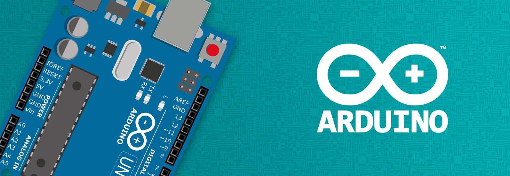
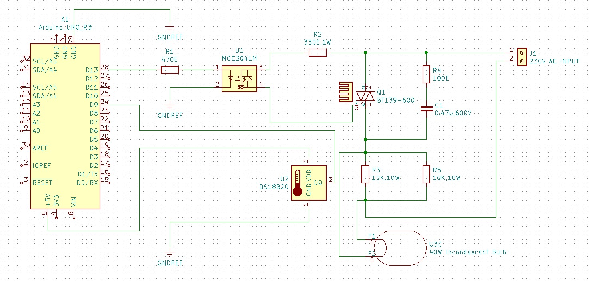
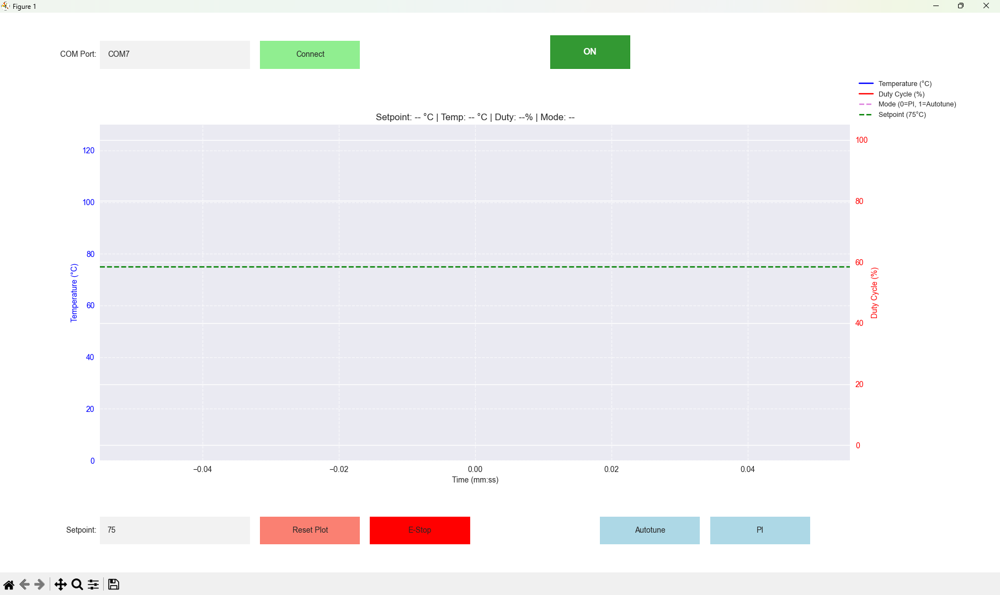

# PID AutoTuning: Arduino Temperature Controller

Closed-loop temperature control on an Arduino Uno. A DS18B20 measures the
temperature of a resistive heater, and the Arduino switches the heater through
an opto-isolated TRIAC. The controller runs PI control and can tune its own
gains with a Ziegler–Nichols relay test. A Python GUI plots the run live, sends
commands and logs the data to Excel.

## Repository layout

```
PID-AutoTuning/
├── firmware/
│   └── pid_autotune/
│       └── pid_autotune.ino     Arduino sketch: sensing, PI control, autotune, EEPROM
├── gui/
│   ├── pid_monitor.py           live plot, controls, safety alerts, Excel logging
│   └── requirements.txt
├── docs/
│   └── images/                  schematic, GUI screenshot, banner
├── LICENSE
└── README.md
```

## Hardware

| Part                  | Details                                                       |
|-----------------------|---------------------------------------------------------------|
| Controller            | Arduino Uno (any ATmega328P board works)                      |
| Temperature sensor    | DS18B20 on OneWire, 4.7 kΩ pull-up from data to 5 V           |
| Heater                | 2 × 10 kΩ 10 W resistors in parallel                          |
| Heater switching      | MOC3041 zero-cross opto-triac driving a BT139 TRIAC           |

### Wiring



| Signal          | Arduino pin | Notes                                          |
|-----------------|-------------|------------------------------------------------|
| DS18B20 data    | D9          | 4.7 kΩ pull-up to 5 V                          |
| DS18B20 VCC     | 5V          |                                                |
| DS18B20 GND     | GND         |                                                |
| Heater control  | D13         | to the MOC3041 LED through a 330 Ω resistor    |

> The heater side runs at mains voltage. Keep it enclosed, fused and fully
> isolated from the low-voltage side before powering it.

## Firmware

### Setup

1. Install the [Arduino IDE](https://www.arduino.cc/en/software).
2. From *Sketch → Include Library → Manage Libraries*, install:
   - **OneWire** (Paul Stoffregen)
   - **DallasTemperature** (Miles Burton)
   - **TimerOne** (Paul Stoffregen)
3. Open `firmware/pid_autotune/pid_autotune.ino`, select *Arduino Uno* and the
   right port, then upload.

### How it works

- **Heater drive:** Timer1 fires every 20 ms and switches the heater pin on or
  off, giving a 2 s time-proportioning window with 1 % steps. With a
  zero-cross opto-triac this switches whole mains cycles.
- **PI control:** `Kp = 10`, `Ki = 2` by default, or the autotuned gains once
  a tune has finished. The integral is reset while the error is 4 °C or more,
  to stop windup during heat-up.
- **Autotune:** the heater runs full on below the setpoint and off above it.
  After six setpoint crossings (three cycles), the overshoot and period give
  `Ku` and `Tu`, and the Ziegler–Nichols PI rule gives `Kp = 0.45 Ku`,
  `Ki = 0.54 Ku / Tu`. The run also records delay, rise, peak and settle times.
- **EEPROM:** the setpoint and the autotune timings are kept across power
  cycles.
- **Sensor loss:** if the DS18B20 stops responding, the heater is switched off
  and autotune is cancelled.

### Serial commands

9600 baud, one command per line.

| Command    | Action                                         |
|------------|------------------------------------------------|
| `AUTOTUNE` | start the autotune run                         |
| `PI`       | run PI control (also resumes after a stop)     |
| `Sxx.x`    | set the setpoint, e.g. `S75` or `S72.5`        |
| `STOP`/`H0`| heater off, control stopped                    |

### Serial output

One line per loop:

```
Setpoint: 75.00, Temp: 74.81 C, Duty: 37%, Mode: PI
```

After an autotune, each line also carries `DT`, `RT`, `PT`, `ST` (delay, rise,
peak and settle times in ms) and the tuned `Kp` and `Ki`.

## GUI



### Setup

Python 3.8 or newer. The alert sounds use `winsound`, so the GUI runs on
Windows.

```
cd gui
pip install -r requirements.txt
python pid_monitor.py
```

### Using it

1. Enter the Arduino's COM port (default `COM7`) and click **Connect**.
2. Type a setpoint and press Enter.
3. Click **Autotune** to tune, or **PI** to run with the current gains.
4. **E-Stop** turns the heater off at once; **Reset Plot** clears the graph.

### What it shows and does

- Live temperature, duty cycle and mode against time, with the setpoint line.
- Setpoint limits: anything at or above 85 °C is refused, and anything above
  80 °C asks for confirmation.
- Over-temperature alerts: a warning above 100 °C that turns the heater off
  after 5 s unless overridden, and an immediate shutdown above 115 °C.
- Every reading is saved to `temperature_data.xlsx` in the folder it runs from.
- A built-in test mode simulates high temperatures to check the alerts. Set
  `HIDE_TEST_FEATURES = False` at the top of `pid_monitor.py` to show it.

## License

MIT, see [LICENSE](LICENSE).
